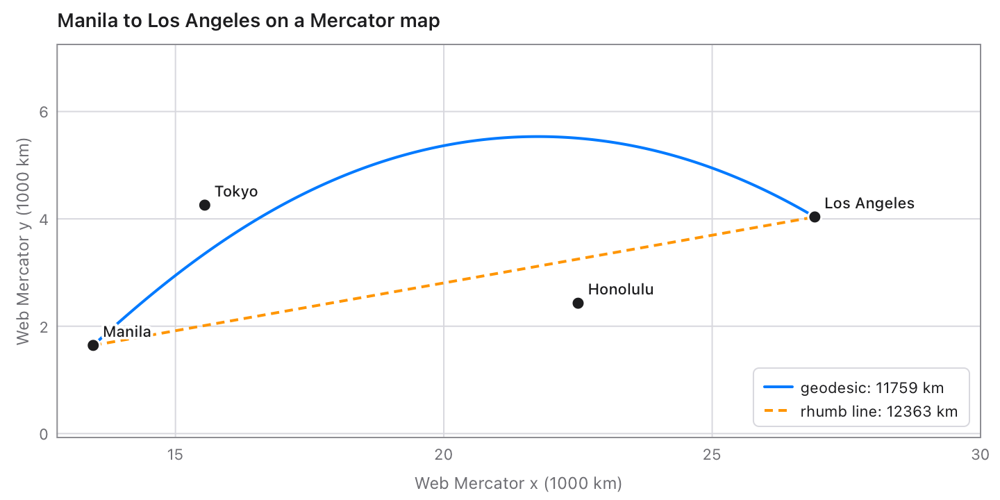
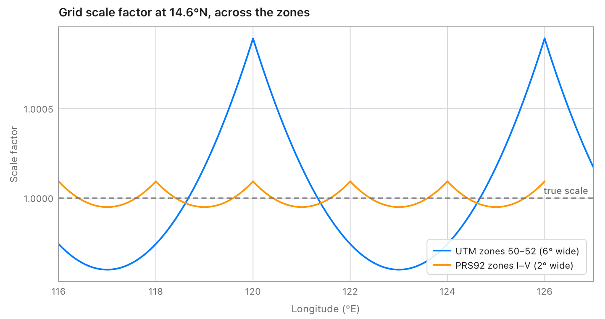

# geodesy

Geodesy for [Tessel](https://tessel-lang.syncster.dev) programs: exact
distances, azimuths and areas on the ellipsoid, rhumb lines, map
projections, datum shifts, and coordinate systems by EPSG code, PROJ string
or WKT, with degrees as text and MGRS. Geodesics are Karney's algorithms, as
in GeographicLib, good to about 15 nanometres anywhere on the Earth.
Projections and datum shifts follow PROJ, the engine of QGIS and GDAL, and
agree with it to the nanometre for every one of the 5144 EPSG projected
systems geodesy has.

```tessel
import geodesy

fn main() {
    // Distances and bearings on WGS84 (Karney's geodesics).
    let r = geodesy.inverse(14.5995, 120.9842, 10.3157, 123.8854)     // Manila to Cebu
    print("{r.distance} m, setting off at {r.azimuth1}°")             // 569218.2057… m, 146.029…°

    // Coordinate systems by EPSG code, PROJ string or WKT.
    let wgs = geodesy.wgs84Crs()
    let zone3 = geodesy.epsg(3123) ?? wgs                               // PRS92 / Philippines zone 3
    let (e, n) = geodesy.transform(120.97695, 14.58285, from: wgs, to: zone3)
    print("{e} {n}")                                                  // 497369.807 1612820.042

    // Grid to ground: the scale factor and convergence there.
    let (lon, lat) = zone3.toLonLat(e, n)
    let (k, _, convergence) = zone3.gridFactors(lon, lat)
    print("k = {k}, convergence {convergence}°")                      // k = 0.99995009, -0.0061°

    // Degrees as text, and MGRS.
    print(geodesy.formatLatLon(14.58285, 120.97695))                  // 14°34'58.26"N 120°58'37.02"E
    print(geodesy.toMGRS(14.58285, 120.97695))                        // 51PTS8205113157

    // The area of a lot from the GPS readings at its corners.
    let (area, perimeter) = geodesy.polygonArea([14.58285, 14.58285, 14.58375, 14.58375],
                                                [120.97695, 120.97788, 120.97788, 120.97695])
    print("{area} m², {perimeter} m")                                 // 9979.24 m², 399.59 m
}
```



## Using it

Add it to a project (Tessel 0.10 or later):

```sh
tessel add geodesy
```

then `import geodesy`. Latitudes and longitudes are in degrees; lengths in
metres. Points are (x, y): easting and northing, or longitude and latitude,
whatever order EPSG lists the axes in.

## On the ellipsoid

| Function | Gives |
|---|---|
| `inverse(lat1, lon1, lat2, lon2, on:)` | The shortest path: `distance`, `azimuth1` and `azimuth2` (degrees clockwise from north), and its `arc`, `reducedLength`, `scale12`, `scale21` and `area` to the equator. |
| `distance(lat1, lon1, lat2, lon2, on:)` | Just the length. |
| `direct(lat, lon, azimuth:, distance:, on:)` | The point that far along the geodesic, and the azimuth there. |
| `line(lat, lon, azimuth:)`, `lineBetween(lat1, lon1, lat2, lon2)` | A `GeodesicLine`: `position(distance)` gives points along it, `points(n)` n evenly spaced ones, for drawing. |
| `polygonArea(lats, lons, on:)` | The area (m², positive counterclockwise) and perimeter of a polygon of geodesics: a lot, a province or a continent, round a pole or across 180°. |
| `trackLength(lats, lons, on:)` | The length of a GPS track. |
| `rhumb(lat1, lon1, lat2, lon2)` | The rhumb line (constant bearing): its length and azimuth. |
| `rhumbDirect(lat, lon, azimuth:, distance:)`, `rhumbPoints(…, count:)` | Points along a rhumb line. |

`on:` is the ellipsoid: `wgs84()` unless you say, `ellipsoid(a:, f:)`, or one
of PROJ's 46 by name: `ellipsoidNamed("clrk66")`, `"GRS80"`, `"intl"`,
`"bessel"`, `"airy"`…

## Coordinate systems

A `Crs` is latitude and longitude on a datum, or a projection of them, with
the datum's shift to WGS84.

| Function | Gives |
|---|---|
| `epsg(code)` | One of 578 geographic and 5144 projected EPSG systems, or nil: UTM, the Philippine zones of PRS92 (3121–3125) and Luzon 1911 (25391–25395), Web Mercator, US state planes, national grids… |
| `crs(text)` | From "EPSG:3123", a PROJ string, or WKT. |
| `fromProj(text)` | From a PROJ string, like `+proj=tmerc +lat_0=0 +lon_0=121 +k=0.99995 +x_0=500000 +ellps=clrk66 +towgs84=…`. |
| `fromWkt(text)` | From WKT1 (a shapefile's `.prj`, as GDAL or Esri write it) or WKT2. |
| `utm(zone:, south:)`, `utmFor(lat, lon)`, `utmZone(lat, lon)` | WGS84 UTM systems, with Norway's and Svalbard's zones. |
| `wgs84Crs()` | WGS84 latitude and longitude (EPSG:4326). |
| `epsgCodes(search:)` | The codes whose names contain a text: `epsgCodes(search: "Philippines")`. |
| `transform(x, y, from:, to:)`, `transformAll(xs, ys, from:, to:)` | Points from one system to another. |

| `Crs` method | Gives |
|---|---|
| `toLonLat(x, y)`, `fromLonLat(lon, lat)` | To and from longitude and latitude on its own datum. |
| `toWGS84(x, y)`, `fromWGS84(lon, lat)` | To and from WGS84 longitude and latitude. |
| `gridFactors(lon, lat)` | The grid's scale along the meridian and the parallel, and the convergence (as PROJ's `get_factors`): for reducing ground distances to the grid. |
| `proj()`, `wkt()` | The system as a PROJ string, and as WKT1 for a `.prj` file. |

Projections: Transverse Mercator (by Krüger's series to 6th order, exact
to nanometres), UTM, UPS, Mercator, Web Mercator, Lambert conformal conic
(1SP, 2SP, variant B), Albers equal-area, polar, oblique and equatorial
stereographic, oblique stereographic on the Gauss sphere (EPSG's), Lambert
azimuthal equal-area, equidistant cylindrical, and Cassini–Soldner (with
EPSG's hyperbolic variant). Not yet: Hotine oblique Mercator, Krovak and
the Swiss oblique Mercator, which leave out 114 EPSG systems.

Datum shifts are 7-parameter Helmert transformations through WGS84, as
PROJ does them: the one PROJ itself picks from the EPSG database for each
datum (418 of the 578), with its prime meridian where that differs (MGI
Ferro). A datum without one (`shiftKnown` false) is taken as WGS84, as
PROJ's "ballpark" does. PRS92's shift is EPSG's (good to about a metre);
Luzon 1911's is the one for the Philippines outside Mindanao.



## Degrees as text and MGRS

| Function | Gives |
|---|---|
| `readAngle(text)` | Degrees from `14.5995`, `14°35'45.2"N`, `14 35 45.2 S`, `N14°35.753'`, `121:30:00E`, `121d30m15s W`, `40d30'N`… |
| `readLatLon(text)` | (latitude, longitude) from `14.5995, 120.9842`, `14°35'58.2"N 120°59'03.1"E`, `N14 35 58.2 E120 59 03.1`… |
| `formatAngle(degrees, style:, decimals:, hemispheres:)` | `14°35'58.20"N` (`.degreesMinutesSeconds`), `14°35.9700'` (`.degreesMinutes`) or `14.5995°` (`.decimal`). |
| `formatLatLon(lat, lon, style:, decimals:)` | `14°35'58.20"N 120°59'03.12"E`. |
| `toMGRS(lat, lon, precision:)` | `51PTS8284814992`: 5 digits for 1 m, fewer for larger squares; UPS letters near the poles. |
| `fromMGRS(text, center:)` | The south-west corner (or middle) of an MGRS square. |

## Mistakes

Points that can't be (a latitude past 90°, NaN) stop the program with a
message, like `geodesy: inverse: a latitude must be from -90 to 90…`.
Reading text returns a `Result` that says what's wrong: `"frob" isn't an
ellipsoid PROJ knows`, `geodesy doesn't have the projection "omerc"`,
`"51PZZ" isn't a 100 km square of zone 51`, `minutes and seconds must be
below 60`.

## Speed

On an Apple M5 Pro: 100 000 transforms through a datum shift (WGS84 to
PRS92 zone 3) take 0.13 s, and 100 000 geodesic distances 0.28 s.

## Tests

```sh
tessel run tests
```

checks 138 677 values: the cases in `tests/cases.json` and more by hand.

- 2400 geodesics on WGS84, Clarke 1866, a sphere, and very flat and
  prolate ellipsoids (nearly antipodal points, poles, the equator,
  meridians, coincident points), 200 lines, 300 polygons (lots to
  continents, across 180°, round the poles) and their tracks, against
  GeographicLib.
- 300 rhumb lines, against SciPy's quadrature.
- Every one of the 5144 EPSG projected systems at random points in its area,
  forward and back; 287 datums' shifts to WGS84, both by their Helmert and
  by PROJ's own EPSG transformation; 297 transforms between systems on
  different datums; and 600 systems read from PROJ strings and WKT (GDAL,
  Esri and WKT2, with and without EPSG codes), written back and read again.
  All against PROJ 9.3 through pyproj.
- 1500 MGRS references against the mgrs package.

`.venv/bin/python tools/gen/gen.py` makes `tables.tsl` from PROJ's database,
and `.venv/bin/python tools/oracle/oracle.py` the cases (they need pyproj,
geographiclib, mgrs and scipy in `.venv`).

## What's where

| File | |
|---|---|
| `geodesic.tsl` | `Ellipsoid`, `ellipsoid`, Karney's geodesics, `GeodesicLine`, `polygonArea`, `trackLength`. |
| `rhumb.tsl` | Rhumb lines, and the meridian arc. |
| `projections.tsl` | `Projection` and every projection's formulas. |
| `crs.tsl` | `Crs`, datum shifts, `transform`, EPSG, PROJ strings, UTM zones. |
| `wkt.tsl` | Reading and writing WKT. |
| `text.tsl` | Degrees as text. |
| `mgrs.tsl` | MGRS. |
| `ellipsoids.tsl` | `wgs84()`. |
| `tables.tsl` | Ellipsoids, units, meridians and the EPSG systems, from PROJ (generated). |
| `examples/` | Draws the pictures in `docs/` with the [chart](https://chart-package.syncster.dev) library: `tessel run examples`. |
| `tools/` | Make the tables and the test cases. |

## Licence

MIT: see [LICENSE](LICENSE). The geodesic algorithms are C. F. F. Karney's
(GeographicLib, MIT). The EPSG data in `tables.tsl` are from the EPSG
Geodetic Parameter Dataset (© IOGP) as PROJ ships it.
